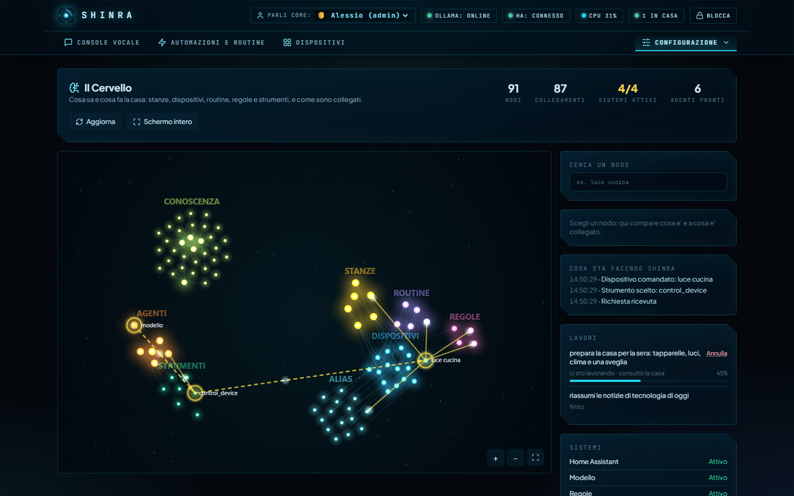

# «Ci penso» — le richieste che prendono tempo

Alcune richieste non si risolvono in pochi secondi: una frase con quattro cose da fare, una domanda che il modello fatica a capire, un server
che in quel momento sta facendo altro. Invece di tenerti davanti a un cerchio che gira, Shinra **risponde subito** e continua a lavorare.

*Da quando:* `0.9.0` (in lavorazione, già sul server). Il piano generale è nella [ROADMAP](ROADMAP.md) e nell'[ADR 0013](adr/0013-agenti-e-modelli-che-imparano.md).

## Cosa vedi

1. Scrivi (o dici) una richiesta dalla console. Se passano più di **25 secondi** senza risposta, compare:
   *«Ci sto lavorando: ti avviso appena ho finito.»*
2. La chat è di nuovo libera: puoi chiedere altro, cambiare scheda, chiudere il telefono.
3. Nel **Cervello** (Configurazione › Il Cervello), accanto a «Cosa sta facendo Shinra», compare il riquadro **Lavori**: la tua richiesta, a che punto è
   (fase e percentuale) e **Annulla**.
4. Quando ha finito, **l'esito arriva in chat come una risposta qualunque** (e a voce, se la voce è accesa), più un avviso che dice solo che è pronto
   («Ho finito»): sul telefono, nella dashboard o su ntfy, secondo le tue preferenze di notifica (categoria *Lavori lunghi finiti*).

È la **stessa richiesta** che continua: non si rifà e non perde quello che aveva già fatto.

<p align="center">
  
</p>

## Cosa succede se qualcosa va storto

| Situazione | Cosa vedi |
| :--- | :--- |
| **Supera il tempo massimo** (15 minuti di serie) | «Non sono riuscito a finire in tempo», con il consiglio di spezzare la richiesta. Lo stato è *non riuscito · tetto di tempo* |
| **Il servizio si riavvia** mentre ci lavora | Il lavoro diventa **interrotto** e **non riparte da solo**: non si sa a che punto fosse, e potrebbe aver già comandato qualcosa. Lo rifai tu, se vuoi |
| **Lo annulli** | Si ferma anche la richiesta. Un lavoro già finito non cambia |
| **Hai già 5 lavori in corso** | La sesta richiesta non diventa un lavoro: aspetta come prima, una risposta lenta è meglio di nessuna |
| **Un errore** | «Non sono riuscito a finire quello che mi hai chiesto». Il dettaglio tecnico resta nel registro del server, non in chat |

I lavori pesanti vanno **uno alla volta** e cedono il passo alla chat e a Home Assistant: su un server senza GPU due insieme sono peggio di uno dopo l'altro.

## Privacy

- Un lavoro è **tuo**: lo vedi, lo annulli e leggi l'esito solo tu. Per un altro profilo, anche un amministratore, **non esiste**.
- La richiesta e l'esito sono **parole tue**: restano nel database del server, **non escono nei salvataggi** e «Dimentica tutto di me» li cancella.
- Il registro delle azioni dice che un lavoro è nato e com'è finito (identificativo, stato, durata), **mai** cosa si era chiesto. L'avviso («Ho finito») non porta il contenuto:
  viaggia verso più canali e uno può essere un telefono sul tavolo.

## Regolarlo

In `config/config.yaml`:

```yaml
lavori:
  tetto_secondi: 900    # un lavoro non dura più di così (fra 10 secondi e un'ora)
  soglia_secondi: 25    # dopo quanti secondi una richiesta diventa un lavoro; 0 = si aspetta sempre, come prima
```

Con un server lento anche una domanda semplice può superare i 25 secondi: se preferisci aspettare le risposte normali e usare «ci penso» solo per le richieste
davvero lunghe, alza la soglia (per esempio a 50) e riavvia il servizio. Per spegnere la funzione basta `0`.

Vale solo per la **dashboard** (che sa ricevere la risposta più tardi). Alexa e i punti di ascolto a voce aspettano come sempre.

## Per chi sviluppa

- Il servizio è `services/lavori.py`, le regole del gioco (stati, tetti) `domain/lavori.py`, le rotte `GET /api/lavori`, `GET /api/lavori/{id}`, `POST /api/lavori/{id}/annulla` (vedi
  [API](API.md)). Sei stati: in coda, in corso, fatto, fallito, annullato, interrotto; un lavoro finito non torna indietro.
- La consegna passa dall'evento `lavoro.finito` (solo al browser di chi ha chiesto) e da un avviso senza contenuto (`services/lavori_consegna.py`).
- I test sono `tests/unit/test_lavori.py` e `tests/unit/test_ci_penso.py` (con un websocket vero) e, per l'interfaccia, `tests/gesti/lavori.spec.mjs` e `tests/gesti/ci-penso.spec.mjs`.
